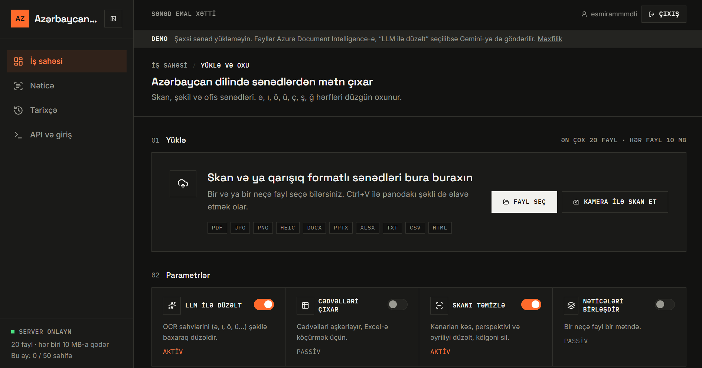
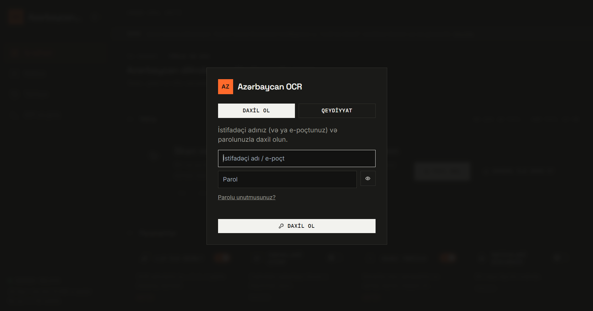
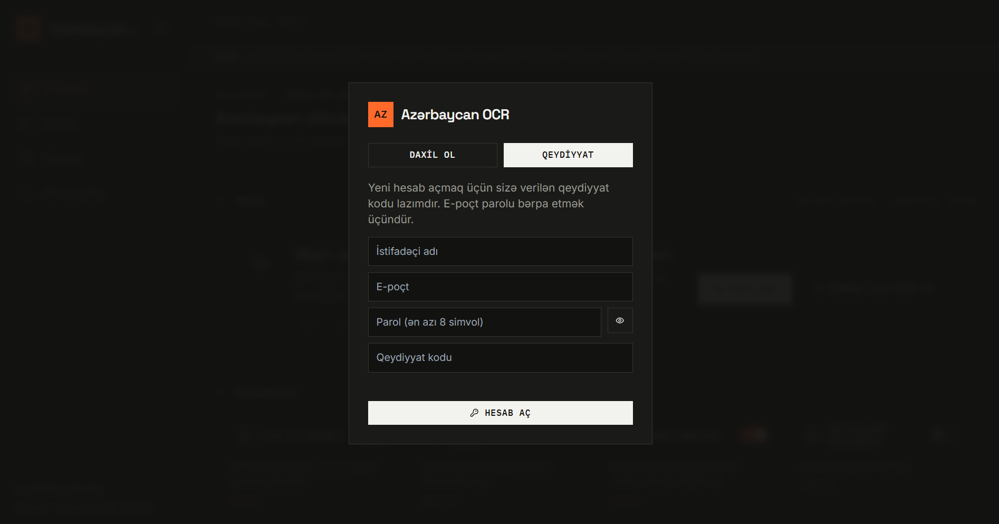
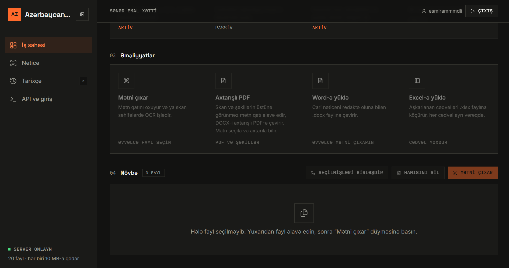
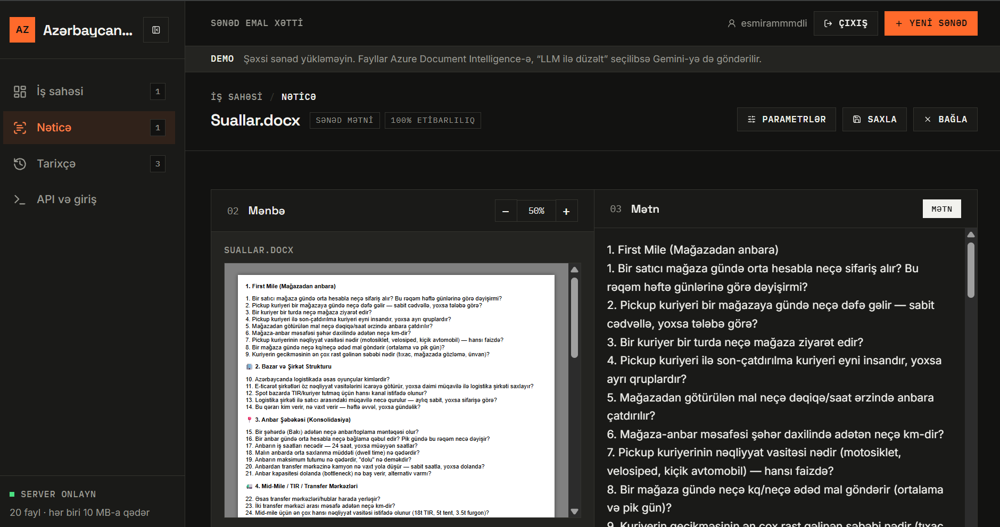
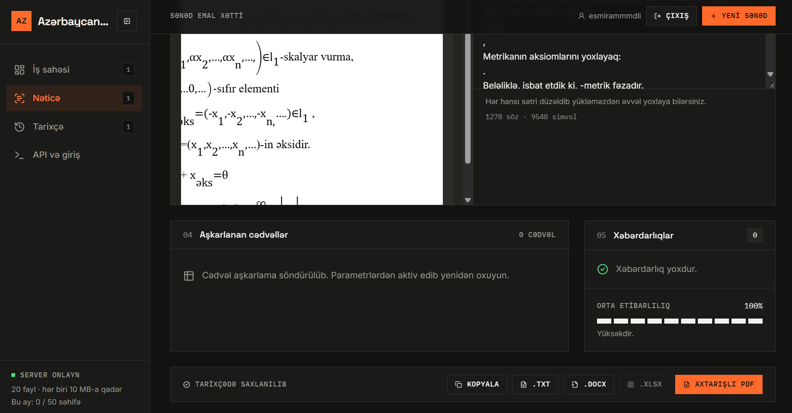
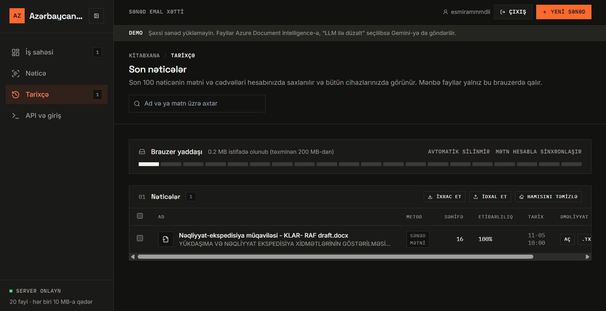
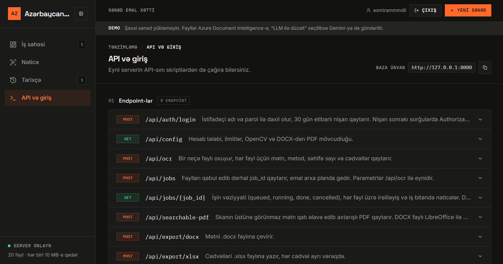
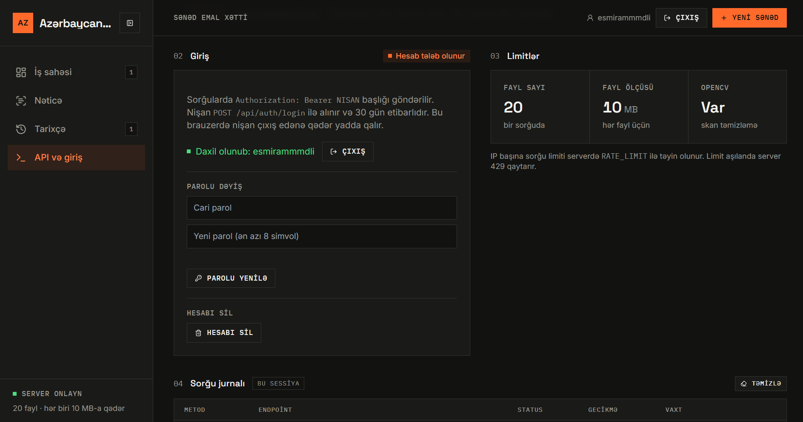
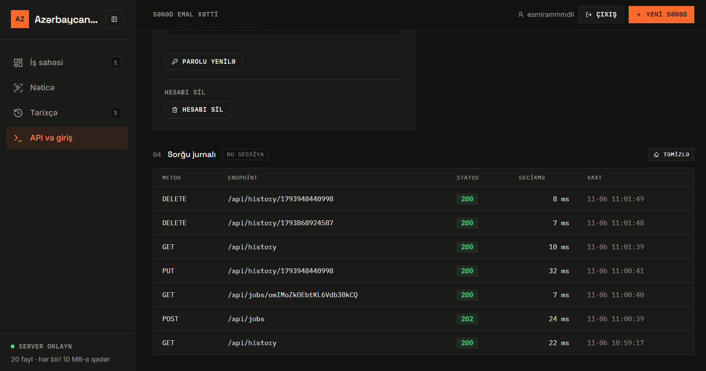

# Azerbaijani OCR

A web app that extracts text from Azerbaijani scans, photos and office documents. Azure Document Intelligence reads the text, then Gemini looks at the original image and fixes OCR mistakes in letters such as `ə`, `ı`, `ö`, `ü`, `ç`, `ş`, `ğ`.

The interface is in Azerbaijani.

**Live demo:** https://azerbaijani-optical-character-recognition.onrender.com/

Sign-up needs a registration code. The demo runs on Render's free plan, so the first request after a period of inactivity can take about a minute while the service wakes up. Do not upload personal documents to it.



## Features

- PDF, images (JPG, PNG, BMP, TIFF, WEBP, GIF, HEIC) and office files (DOCX, PPTX, XLSX, TXT, CSV, HTML)
- Batch processing with optional merging of results; pick files, drag and drop, or paste an image with `Ctrl+V`
- Multi-page scanning with the device camera
- Scan cleanup (OpenCV): crop edges, fix perspective and skew, remove shadows
- LLM correction, with raw OCR vs. corrected text comparison
- Table detection with Excel export (one sheet per table)
- Download results as `.txt` or `.docx`
- Searchable PDF: an invisible text layer is added on top of the scan; DOCX files are converted to PDF with LibreOffice
- Long-running work goes through a background queue and is tracked by `job_id`
- Accounts: sign-up, login, password reset, email verification; history is stored on the server and visible on every device
- Built-in API reference, account management and a per-session request log
- Per-IP rate limiting

## Screenshots

### Login and sign-up

Sign-up requires the registration code set via `APP_PASSWORD`. The login field accepts a username or an email address.

| Login | Sign-up |
|---|---|
|  |  |

### Workspace

Upload files, choose options (LLM correction, table extraction, scan cleanup, merge results), then process the queue.




### Result

The source document is on the left and the extracted text on the right; the text can be edited before downloading. Below are detected tables, warnings, average confidence and export buttons (copy, `.TXT`, `.DOCX`, `.XLSX`, searchable PDF).





### History

The text and tables of the last 100 results are stored in the account and are visible on all devices. Source files stay only in the browser that processed them (IndexedDB). History can be exported and imported.



### API and account

The same server API can be called from scripts. This page lists the endpoints, account actions (log out, change password, delete account), limits and the request log of the current session.







## Pipeline

```
File ──► format check
          │
          ├─ DOCX / PPTX / XLSX / TXT / CSV / HTML ──► direct text extraction (no OCR)
          ├─ digital PDF (has a text layer)        ──► direct text extraction (no OCR)
          └─ scanned PDF / image
                 │
                 ├─ (optional) OpenCV: crop edges, fix perspective and skew, remove shadows
                 ├─ Azure Document Intelligence (prebuilt-read; prebuilt-layout for tables; locale=az)
                 ├─ Unicode normalization (ǝ → ə)
                 └─ (optional) Gemini: OCR text + image ──► corrected text
```

## Tech stack

| Part | Choice |
|---|---|
| Backend | Python 3.12, FastAPI, Uvicorn |
| OCR | Azure Document Intelligence |
| Correction | Google Gemini (`google-genai`) |
| Scan cleanup | OpenCV, Pillow, pillow-heif |
| Documents | PyMuPDF, python-docx, python-pptx, openpyxl, LibreOffice (DOCX → PDF) |
| Database | SQLite (local) or Postgres (`DATABASE_URL`, e.g. Neon) via SQLAlchemy |
| Frontend | `frontend/index.html`, a single file served by the same server |
| Other | slowapi (rate limiting), Sentry (optional), Brevo (email) |

## Getting started

Copy the example environment file and fill in at least the Azure values:

```bash
cp backend/.env.example backend/.env      # Windows: copy backend\.env.example backend\.env
```

`backend/.env` is git-ignored. Never commit it.

Windows (PowerShell):

```powershell
cd backend
python -m venv venv
.\venv\Scripts\Activate.ps1
python -m pip install -r requirements.txt
python -m uvicorn main:app --reload
```

macOS / Linux:

```bash
cd backend
python3 -m venv venv
source venv/bin/activate
python -m pip install -r requirements.txt
python -m uvicorn main:app --reload
```

Then open http://127.0.0.1:8000. The frontend in `../frontend` is served by the same server.

Searchable PDF from DOCX needs LibreOffice (`soffice`). The Docker image installs it. Locally, set `SOFFICE_PATH` if it is not found automatically; `GET /api/config` reports availability in the `docx_pdf` field.

### Environment variables

| Name | Required | Description |
|---|---|---|
| `AZURE_DI_ENDPOINT` | yes | Azure Document Intelligence endpoint |
| `AZURE_DI_KEY` | yes | Azure key |
| `GEMINI_API_KEY` | yes | Without it LLM correction is disabled and raw OCR is returned |
| `LLM_MODEL` | yes | Default: `gemini-3.5-flash` |
| `LLM_FALLBACK_MODEL` | yes | Backup model used when the main model fails |
| `APP_PASSWORD` | yes | Registration code. When set, account mode is enabled (sign-up, login, server-side history) |
| `SESSION_SECRET` | on a server | Random string used to sign login and reset tokens |
| `TOKEN_DAYS` | no | Login token lifetime in days, default `30` |
| `DATABASE_URL` | yes | External Postgres (e.g. Neon). Default: local SQLite file in `backend/data/` |
| `RATE_LIMIT` | yes | OCR requests per IP, default `20/minute` |
| `AUTH_RATE_LIMIT` | no | Login and sign-up attempts per IP, default `10/minute` |
| `ALLOWED_ORIGINS` | no | CORS origins, default `*` |
| `MAX_FILES` | no | Files per request, default `20` |
| `MAX_SIZE_MB` | no | Size per file, default `10` |
| `MAX_TOTAL_MB` | no | Total size per request, default `40` |
| `AZURE_MAX_MB` | no | Larger scans are compressed before being sent to Azure, default `3.5` |
| `JOB_WORKERS` | no | Jobs processed concurrently, default `2` |
| `MAX_ACTIVE_JOBS` | no | Limit of queued plus running jobs, default `6` |
| `JOB_TTL_SECONDS` | no | How long finished jobs stay in the database, default `21600` (6 hours) |
| `HISTORY_MAX` | no | History entries kept per user on the server, default `100` |
| `PDF_FONT` | no | Path to a Unicode `.ttf` for searchable PDF |
| `SOFFICE_PATH` | no | Path to LibreOffice (`soffice`) if not found automatically |
| `BREVO_API_KEY` | yes | Brevo API key for password reset and verification emails |
| `MAIL_FROM` | yes | Verified sender address in Brevo |
| `MAIL_FROM_NAME` | no | Sender name, default `Azərbaycan OCR` |
| `APP_URL` | no | Base URL used in email links. On Render, `RENDER_EXTERNAL_URL` is used automatically |
| `RESET_MINUTES` | no | Password reset link lifetime, default `60` |
| `VERIFY_HOURS` | no | Email verification link lifetime, default `24` |
| `REQUIRE_EMAIL_VERIFICATION` | no | Default `1`: with a mail service, unverified accounts cannot log in. `0` disables it |
| `SENTRY_DSN` | yes | If set, errors are sent to Sentry (passwords, request bodies and IPs are not sent) |
| `SENTRY_ENV` | no | Sentry environment name, default `production` |
| `MAIL_CONSOLE` | no | `1` prints emails to the terminal instead of sending them (local testing only) |

## Accounts and password recovery

- Sign-up needs a username, email, password (at least 8 characters) and the registration code (`APP_PASSWORD`).
- Log in with a username or an email address. The login token is valid for 30 days.
- "Forgot password?" emails a one-time link valid for one hour (`POST /api/auth/forgot`, `POST /api/auth/reset`). Changing the password signs out all old sessions.
- If no mail service is configured (`BREVO_API_KEY` and `MAIL_FROM` missing), the link is hidden. Render's free plan blocks SMTP ports, so Brevo's HTTPS API is used.
- After sign-up a verification link is emailed and **no login token is issued until the address is verified**. The user clicks the link, then logs in. Unverified users who try to log in see a message and a "resend link" button (`POST /api/auth/verify`, `POST /api/auth/resend-verification`). Following a password reset link also verifies the address.
- This rule applies only when a mail service is configured (Brevo, SMTP or `MAIL_CONSOLE`). Without one, sign-up logs the user in immediately. Accounts without an email (old accounts) are never blocked. Set `REQUIRE_EMAIL_VERIFICATION=0` to turn the rule off.
- Accounts created with `manage_users.py add` are marked verified.
- On the "API and login" page you can change your password (`POST /api/auth/change-password`) and delete your account (`POST /api/auth/delete-account`, requires the password; the account, jobs and history are deleted).
- `GET /healthz` does not touch the database; use it for uptime monitors such as UptimeRobot.

Command-line user management (run from `backend/`):

```bash
python manage_users.py list                         # list users
python manage_users.py add NAME                     # create an account
python manage_users.py setemail NAME me@example.com # add an email to an old account
python manage_users.py passwd NAME                  # change a password
python manage_users.py delete NAME                  # delete an account and its history
```

The database used is determined by `DATABASE_URL` in `backend/.env`.

## API

In account mode (`APP_PASSWORD` set), send `Authorization: Bearer <token>` with the main requests. Get the token from `POST /api/auth/login`.

| Method | Path | Description |
|---|---|---|
| GET | `/api/config` | Account requirement, limits, OpenCV and DOCX-to-PDF availability |
| POST | `/api/auth/register` | Sign up: username, email, password, registration code (`invite`). Returns `{"pending": true}` when email verification is required, otherwise a token |
| POST | `/api/auth/login` | Log in with username or email, returns a token. `403` with `code: "email_unverified"` if the email is not verified yet |
| GET | `/api/auth/me` | Current user |
| POST | `/api/auth/forgot`, `/api/auth/reset` | Password recovery |
| POST | `/api/auth/verify` | Confirm an email with the token from the link |
| POST | `/api/auth/resend-verification` | Resend the link; authenticate with a Bearer token or `{"username", "password"}` |
| POST | `/api/auth/change-password` | Change password and invalidate old sessions |
| POST | `/api/auth/delete-account` | Delete the account (requires the password) |
| POST | `/api/ocr` | `files` (multiple); options: `fix`, `enhance`, `tables`, `merge`. Waits for the result |
| POST | `/api/jobs` | Same options; returns a `job_id` immediately (`202`) and processes in the background |
| GET | `/api/jobs/{job_id}` | Job status (`queued`, `running`, `done`, `cancelled`), per-file progress and results |
| DELETE | `/api/jobs/{job_id}` | Cancel a job |
| POST | `/api/searchable-pdf` | `files`, `enhance`; returns a searchable PDF |
| POST | `/api/export/docx` | `{"text": "..."}` |
| POST | `/api/export/xlsx` | `{"tables": [[[...]]]}` |
| GET | `/api/history` | Account history |
| PUT | `/api/history/{id}` | Create or update a history entry |
| DELETE | `/api/history/{id}`, `/api/history` | Delete one entry / all history |
| GET | `/healthz` | Health check |

Example:

```bash
TOKEN=$(curl -s -X POST http://127.0.0.1:8000/api/auth/login \
  -H "Content-Type: application/json" \
  -d '{"username":"NAME","password":"PASSWORD"}' | python -c "import sys,json;print(json.load(sys.stdin)['token'])")

curl -X POST "http://127.0.0.1:8000/api/ocr?fix=true" \
  -H "Authorization: Bearer $TOKEN" \
  -F "files=@document.pdf"
```

Limits: up to 20 files, 10 MB per file, 40 MB total (`MAX_FILES`, `MAX_SIZE_MB`, `MAX_TOTAL_MB`). When the rate limit is exceeded the server returns `429`.

## Measuring quality (CER / WER)

1. Put 15-20 varied documents into `backend/eval/samples/` (printed page, phone photo, skewed scan, receipt, etc.).
2. For each one, write the correct text by hand into `backend/eval/ground_truth/<same-name>.txt` (UTF-8).
3. Run:

```bash
cd backend
python evaluate.py              # raw Azure OCR and Azure + LLM
python evaluate.py --enhance    # with scan cleanup
python evaluate.py --no-llm     # raw Azure OCR only
```

Results are written to `backend/eval/results.md` and `results.csv`. `samples`, `ground_truth` and the results files are in `.gitignore`, so personal documents never reach the repository.

### Results

Not measured yet. After measuring, paste the `results.md` table here and note the number of documents and the model used.

## Tests

```bash
cd backend
python -m pip install -r requirements-dev.txt
python -m pytest -q
```

The tests do not call Azure or Gemini.

## Docker

The image includes LibreOffice and Unicode fonts (needed for `ə` in searchable PDFs).

```bash
docker build -t az-ocr .
docker run --rm -p 8000:8000 --env-file backend/.env az-ocr
```

`backend/.env` is excluded from the image by `.dockerignore`; secrets are passed at run time.

## Deploy (Render)

1. Push the project to GitHub (without `.env`).
2. On render.com: New → Web Service → select the repo.
3. Easiest: choose **Docker** as the language and leave Root Directory empty. The Dockerfile is in the project root.
4. In Environment, add `AZURE_DI_ENDPOINT`, `AZURE_DI_KEY`, `GEMINI_API_KEY`, `LLM_MODEL`, `APP_PASSWORD` and `SESSION_SECRET`.
5. Connect an external Postgres (e.g. Neon) through `DATABASE_URL` so accounts and history survive restarts. A local SQLite file is wiped on redeploy on Render's free plan.
6. Add `BREVO_API_KEY` and `MAIL_FROM` for password reset and email verification.

Without Docker: choose a Python environment, Build Command `pip install -r backend/requirements.txt`, Start Command `cd backend && uvicorn main:app --host 0.0.0.0 --port $PORT`. In that case searchable PDF from DOCX will not work (no LibreOffice).

### Emails landing in spam

Verification and reset emails are sent through Brevo. If `MAIL_FROM` is a free address such as `@gmail.com`, Gmail and others cannot verify that Brevo is allowed to send for that domain, so the message often goes to spam. The reliable fix is to send from your own domain: add the domain in Brevo, publish the SPF, DKIM and DMARC DNS records it gives you, and set `MAIL_FROM` to an address on that domain.

## Privacy

Files are sent to Azure Document Intelligence for processing, and also to Gemini when "LLM correction" is on. Do not upload personal documents to a public demo. In account mode the text and tables of history entries are stored in the database, up to 100 entries per account; uploaded files are deleted after processing and source files stay only in the user's browser. If `SENTRY_DSN` is set, error messages are sent to Sentry.

## Roadmap

- Measure accuracy with CER / WER and publish the results in this file
- Export OCR results as Markdown
